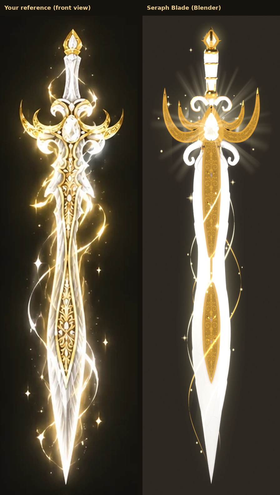
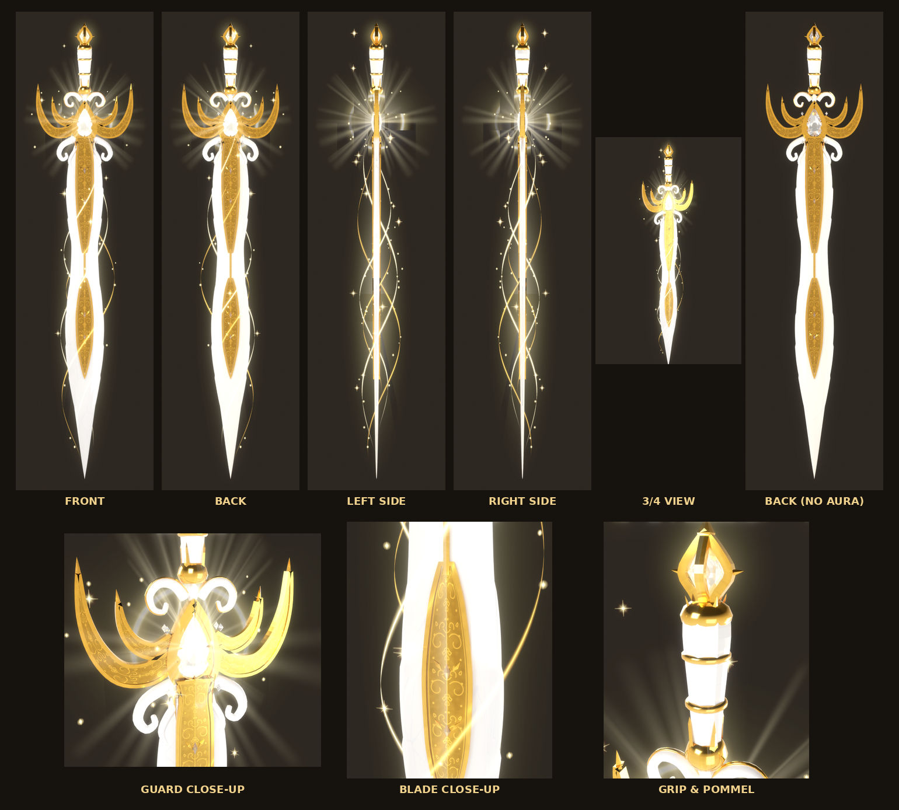
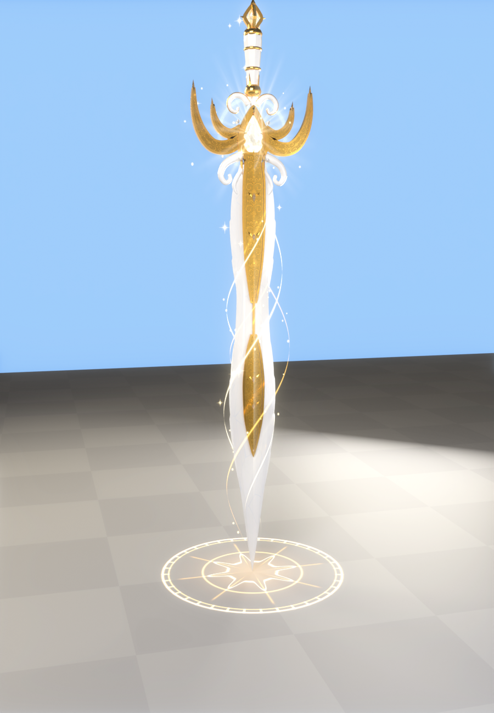
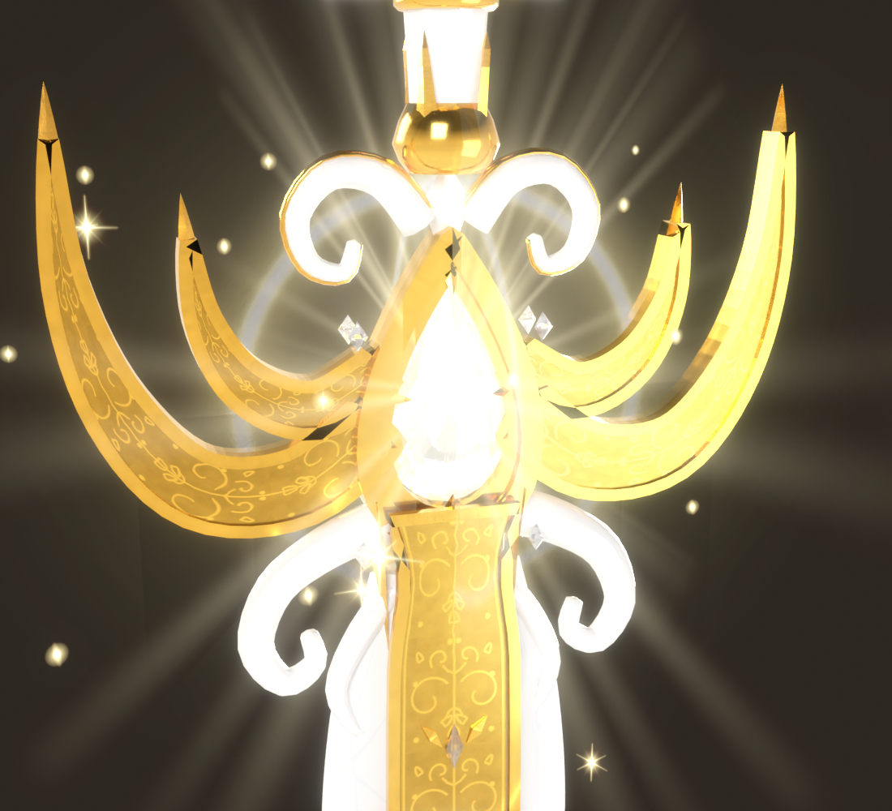

# Seraph Blade

The white-and-gold divine sword from your reference sheet, built in Blender as a true 3D model
and set up as a Roblox tool. It has:

- **Blade:** long and slim, in luminous white crystal, carrying a raised gold filigree channel
  set with small diamonds.
- **Guard:** gold crescents and white scroll curls round a large teardrop diamond that goes
  right through it.
- **Grip:** slim, tapered white crystal with ornate gold collars.
- **Pommel:** a kite-shaped diamond in a gold frame.
- **Aura:** a white-and-gold divine aura, separate from the sword.

| Every view | In game | Guard close-up |
| --- | --- | --- |
|  |  |  |

## How it follows the reference

The front view on your sheet was measured on a grid at 0.0075 studs per pixel, so the sword is
4.9 studs long, with the sheet's proportions. Every outline in `blender/build_seraph.py` comes
from that.

- **Blade:** long and pointed, with the reference's shape: wide at the guard, a waist, a
  leaf-shaped belly, then the point.
  - **Cross-section:** a wide flat carries the gold channel and bevels to clean, sharp edges.
    Below the channel it rises into a central ridge, so the point reads as cut crystal.
  - **Layered sections:** thin layered crystal sections run along both edges in feather-like
    steps.
- **Gold channel:** two panels, joined by a fine gold line, like the reference.
  - **Panels:** each has a raised gold rim round an engraved filigree face (scrolls, leaves, a
    teardrop and pearls).
  - **Gems:** small diamonds are set down the middle, each framed by little gold leaves.
  - **Both sides:** it's modelled on the front and the back of the blade.
- **Guard:**
  - **Gem:** a large teardrop diamond, cut on both faces and going right through the guard,
    in two gold frames with prongs.
  - **Crescents:** two gold crescents per side, each an engraved band in a raised gold rim,
    sweeping up to sharp points.
  - **Curls:** white scroll curls with gold edges above the gem, and big white curls under the
    crescents.
  - **Details:** a small white crystal drop at the top, diamond studs on the frame, and gold
    strips running down into the blade's channel.
  - **Symmetry:** symmetrical from the front, with real depth from the side.
- **Grip:** slim, faceted white crystal, tapering towards the guard, with thin gold rings. An
  ornate gold collar with leaves reaching up sits where it meets the guard.
- **Pommel:** a kite-shaped diamond in crossed gold frames, with a gold point above it, side
  points and a small crown of points under it.

## The divine aura

It's built as separate objects (`export/SeraphAura.fbx`), so you can keep, change or replace
it. Its pieces are:

| Group | Objects | What it is |
| --- | --- | --- |
| White aura | `WhiteAura`, `WhiteHalo`, `WhiteRays` | The main luminous glow round the guard and blade, a soft halo and subtle light rays behind the gem |
| Gold aura | `GoldAura` | The softer, secondary golden glow round the guard, blade and pommel |
| Energy ribbons | `EnergyRibbons`, `EnergyRibbonsGold` | White strands and thinner gold ones swirling round the blade |
| Sparkles | `Sparkles` | Star-like flashes close to the sword |
| Particles | `Particles` | Tiny glowing motes riding the ribbons and drifting round the guard |

There's no smoke, no dark energy and no fire, and the sword itself stays clearly visible. In
Roblox the installer rebuilds the aura with beams and particles, and it moves:

- **Flowing:** light flows along the ribbons, and bright streams race along them now and then.
- **Particles:** sparkles flash and motes drift up.
- **Glow:** the halo and light rays slowly turn, and the light round the guard gently breathes.

## Attacks

- **Swing (click):** a white-gold crescent slash with a bright white edge and star flashes. A
  3-hit combo.
- **Heaven's Verdict (E, gamepad Y, or the on-screen button on mobile):**
  - **Charge:** a halo of light closes in on the guard gem.
  - **Strike:** a pillar of light strikes down on you and a holy circle opens on the ground.
    Two rings of white-gold light burst out all the way round, with bursts of light and stars.
  - **Screen:** a warm white flash.
  - **Damage:** it hits everything within 12 studs.

## Install in Roblox Studio

1. **Import 3D**: `export/SeraphBlade.fbx` (it becomes a model called `SeraphBlade`).
2. **Import 3D**: `export/SeraphVFX.fbx`. This brings in the 12 effect textures.
3. **Model** tab > **Run Script** > `roblox/Installer.lua` (or paste it into View > Command Bar).
4. Press Play. *Seraph Blade* is in your backpack.

The installer reads marker cubes in the import, so the size and orientation come out right
whatever units the importer used. It puts:

- the Tool in **StarterPack**, with a copy in **ServerStorage**;
- the scripts in `ReplicatedStorage.SeraphBlade`, `ServerScriptService.SeraphServer` and
  `StarterPlayerScripts.SeraphClient`.

Running it again updates the scripts and keeps your `Config`. `SWORD_SCALE`, `GRIP_TILT` and
`GRIP_SPIN` at the top of `Installer.lua` resize it and fine-tune how it sits in the hand.

**Tip:** add a `BloomEffect` to Lighting so the white crystal glows.

## The parts in Roblox

The sword is split by component. Where a component mixes materials it's split in two, because
a Roblox mesh has one material:

| Part | Material | Triangles |
| --- | --- | --- |
| `Blade` | White crystal | 2,944 |
| `BladeOrnament` | Gold (the filigree channel and its leaves) | 3,808 |
| `Guard` | Gold (crescents, gem frames, rims, strips) | 3,912 |
| `GuardCurls` | White crystal (the scroll curls and top drop) | 2,168 |
| `Gemstones` | Diamond (guard gem, pommel gem, blade and frame diamonds) | 480 |
| `Grip` | White crystal (becomes the Tool's Handle) | 512 |
| `GripGold` | Gold (grip rings and collar) | 680 |
| `Pommel` | Gold (frames, points, crown) | 744 |

That's 15,248 triangles in all, and every part is well under Roblox's per-mesh limit.

- **Gold:** polished, with the engraved filigree in its texture: one texture that is half plain
  gold and half filigree.
- **White crystal:** `Config.CrystalStyle` = `"Light"` (glowing white, the default), `"Glass"` or
  `"Texture"`.
- **Gems:** `Config.GemStyle` = `"Glass"` (clear diamond, the default), `"Light"` or `"Texture"`.

The build script checks every part before export (`export/mesh_report.json`):

- **Clean meshes:** every piece is closed, with no holes, stray vertices or flat faces.
- **Normals:** all point outward.
- **Transforms:** applied, at 1 Blender unit = 1 stud.
- **Nothing floating:** every piece touches the sword.
- **No hidden extras:** there are no hidden helper meshes.

## Settings

Everything is in `ReplicatedStorage.SeraphBlade.Config`:

- **Colours** and the crystal and gem **styles** (above).
- **Combat:** damage, ranges and cooldowns.
- **Aura:** `Aura` turns it on or off, and `AuraSpeed` sets the flow speed. `Streams`,
  `StreamSpeed` and `HaloPulse` control the moving parts.
- **Attacks:** slash size and the Verdict size.

## Hooking it into Pop or Drop

- `ReplicatedStorage.SeraphBlade.SeraphHit` (a BindableEvent) fires on the server for every
  hit, with `(player, hitInstance, damage, isSpecial)`.
- Tag balloons or anything else **`SwordHittable`** with CollectionService and the sword hits
  them too. It's the same tag your other weapons use.
- Set `Config.Combat.DamageHumanoids = false` to handle damage yourself.

## Views

All in `previews/`:

- `front`, `back`, `left`, `right`
- `angle` (3/4 view)
- `head_closeup`, `blade_closeup`, `pommel_closeup`
- `ingame`
- `model_front`, `model_back`, `model_angle` (the sword without its aura)
- `views.png` (all of them on one sheet)

## Files

| File | What it is |
| --- | --- |
| `export/SeraphBlade.fbx` / `.glb` | The sword: 8 meshes plus 3 tiny marker cubes the installer uses and removes |
| `export/SeraphAura.fbx` / `.glb` | The aura as meshes, separate from the sword |
| `export/SeraphVFX.fbx` / `.glb` | Carrier quads that bring the effect textures into Roblox |
| `export/SeraphBlade.blend` | The Blender scene |
| `roblox/Installer.lua` | Run once in Studio |
| `roblox/*.lua` | The scripts (edit these, then run `build_installer.py`) |
| `blender/build_seraph.py` | Rebuilds everything: `python build_seraph.py --render` (or `--shots=front,angle`) |
| `blender/divine_textures.py` | Every texture: white crystal, gold and filigree, diamonds, and the aura layers |
| `textures/` | Every texture as a PNG |

## Good to know

- I built and checked this in real Blender: renders, the mesh checks above, and the glTF
  validator. The Luau scripts pass a syntax check and a linter. **They have not been run inside
  Roblox Studio yet**, so if anything prints an error, send it to me.
- **The front and back match:** the sword is symmetrical front to back, like the sheet's back
  view, but it's fully modelled in 3D. The gold channel, gem cut and guard have real depth on
  both faces.
