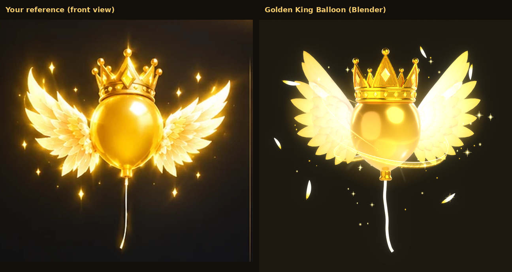
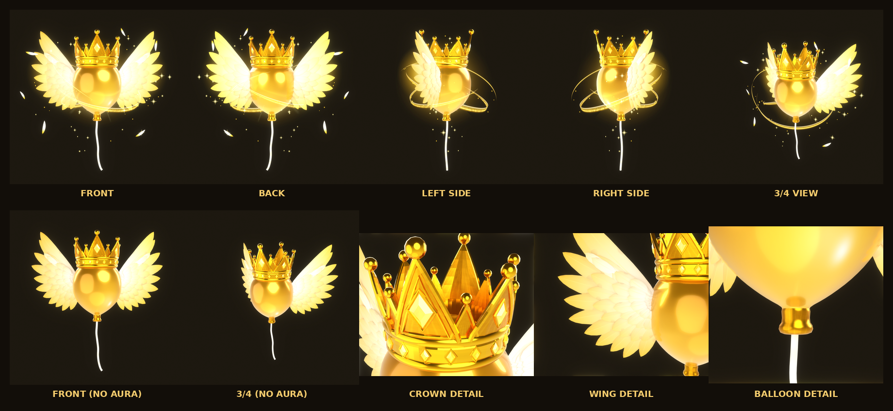
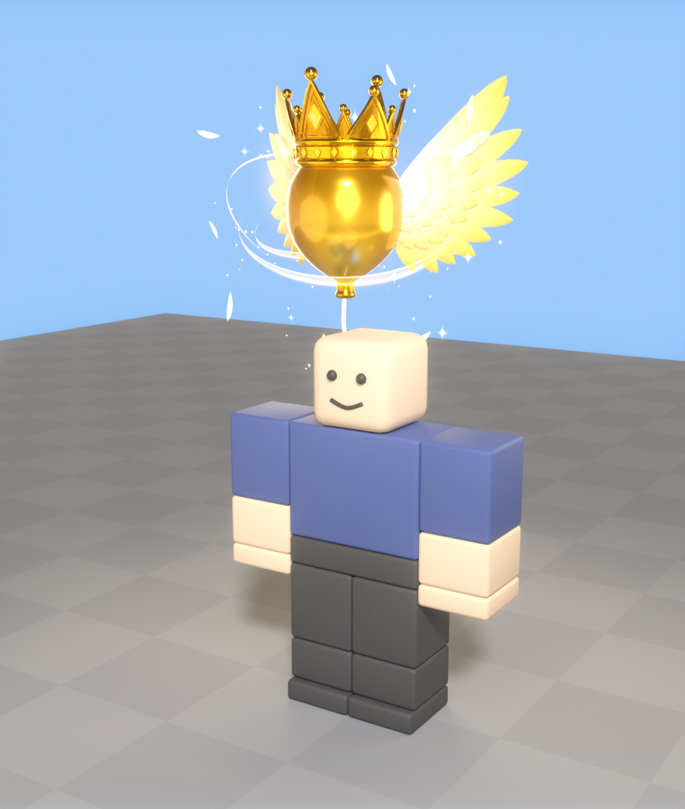
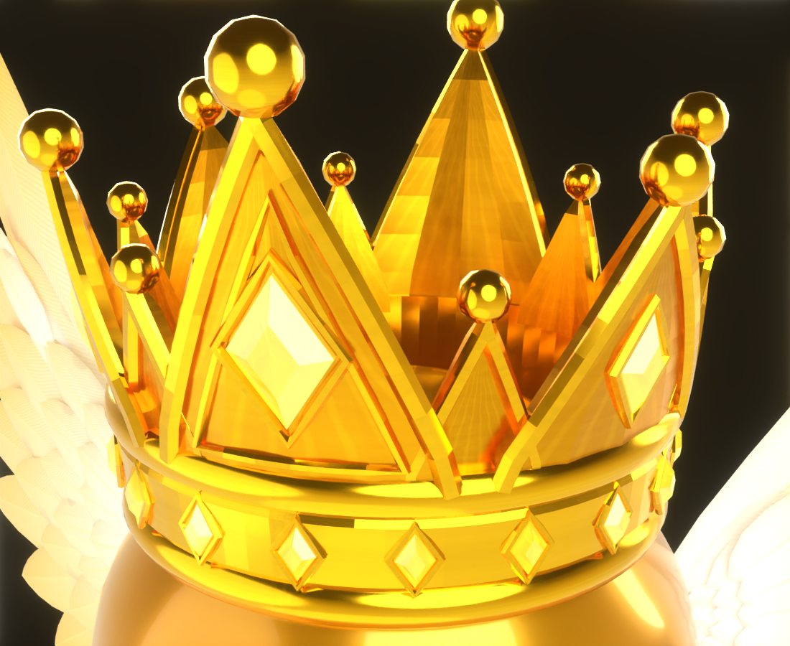

# Golden King Balloon

The golden balloon from your reference sheet, built in Blender as a 3D model and set up as a
Roblox balloon cosmetic that floats beside R15 players. It has:

- **Balloon:** large, glossy metallic gold, a little taller than it is wide.
- **Crown:** a royal king's crown of polished gold set with yellow gems.
- **Wings:** two big layered angel wings of white and ivory feathers with gold bases.
- **Aura:** a golden aura, built separately from the model.



| Every view | On an R15 character | Crown close-up |
| --- | --- | --- |
|  |  |  |

## How it follows the reference

The sheet's front view was measured on a grid at 0.017 studs per pixel, and every outline in
`blender/build_balloon.py` comes from it.

| | Size |
| --- | --- |
| Balloon | 1.8 studs across |
| Wingspan | 4.7 studs |
| Crown top to string end | 5.1 studs |

- **Balloon:** smooth and rounded, slightly taller than wide, fullest just above the middle and
  tapering to the neck.
  - **Gold:** several tones, lighter towards the top and deeper towards the neck, with soft tone
    bands.
  - **Highlight:** a strong glossy highlight on the upper front (on the right as you look at it,
    like the reference) with a small hot glint, on a metallic, glossy surface.
- **Nozzle and string:** a gold collar with a rolled lip where the string goes in.
  - **String:** hangs down about 1.8 studs with a gentle S-curve.
  - **Thickness:** 0.07 studs, thin enough to look natural and thick enough to show in Roblox.
- **Crown:** symmetrical, a little wider than the top of the balloon and sitting round it like a
  real crown.
  - **Band:** rounded rims top and bottom, a fine groove inside each, and a flat face set with
    18 diamond-shaped yellow gems in raised gold bezels.
  - **Points:** six tall triangular points (front and back the tallest) with six smaller ones
    between them.
  - **Point details:** each point has raised gold borders up both sides, a recessed face in
    slightly darker gold, and a gold ball on its tip.
  - **Gems:** the front and back points carry the biggest gems, framed by an inner raised
    triangle. The four side points have smaller gems.
- **Wings:** layered angel wings, 54 feathers each, sweeping back and out and curling gently
  backwards. Each wing has:
  - **Base feather:** a large one along the top edge, curling up into the wing tip.
  - **Outer feathers:** a row of large flight feathers fanning from up-and-out to straight down.
  - **Inner layers:** three layers of shorter feathers on the front and two on the back, getting
    smaller towards the balloon, plus small feathers along the top edge.
  - **Feathers:** every one is a real 3D shape, not a flat card: a pointed vane, a raised quill
    on both faces and edges cupped back.
  - **Colours:** gold at the feather bases, ivory along the vane and bright white at the tips.
    The small inner feathers stay golden cream, so the wing goes from gold near the balloon to
    white at its edge.

## The golden aura

The aura is built as separate objects (`export/GoldenBalloonAura.fbx`), so you can keep, change
or replace it:

| Group | What it is |
| --- | --- |
| `GoldenAura` | A soft yellow-white glow round the balloon, a bigger gold glow behind it, a glow behind each wing, small light rays and a warm light |
| `GoldenParticles` | Tiny golden motes drifting up round it, and golden feathers floating off it |
| `Sparkles` | Star flashes and tiny glowing stars |
| `EnergyTrails` | Thin swirling strands of golden energy round the balloon, with soft swooshes under them |

The aura stays close to the balloon and the balloon, crown and wings stay clearly visible. In
Roblox it moves:

- **Trails:** they turn slowly round the balloon, light flows along them, and bright streaks race
  round them.
- **Glow:** it gently breathes.
- **Extras:** the crown's big gem glints now and then.

## Install in Roblox Studio

1. **Import 3D**: `export/GoldenKingBalloon.fbx`. It becomes a model called `GoldenKingBalloon`.
   Keep the importer's default options.
2. **Import 3D**: `export/GoldenBalloonVFX.fbx`. This brings in the 10 effect textures.
3. **Model** tab > **Run Script** > `roblox/Installer.lua` (or paste it into View > Command Bar).
4. Press **Play**. In Studio every player gets the balloon automatically, so you see it straight
   away.

The installer reads marker cubes in the import, so the size and orientation come out right
whatever units the importer used. It creates:

| Where | What |
| --- | --- |
| `ReplicatedStorage.GoldenKingBalloon` | `GoldenKingBalloon` (the model), `Config`, `BalloonCosmetic`, `Layout`, `Assets` |
| `ServerScriptService.GoldenBalloonServer` | Puts the balloon on players |
| `StarterPlayerScripts.GoldenBalloonClient` | The floating motion and the moving parts of the aura |
| `Workspace.GoldenKingBalloon_Preview` | A copy to look at, which you can delete |

Running it again updates the scripts and keeps your `Config`. `BALLOON_SCALE` at the top of
`Installer.lua` resizes the balloon and its aura.

**Tip:** add a `BloomEffect` to Lighting (Intensity about 0.6, Threshold about 0.9). That gives
the soft glow from the reference.

### The model in Roblox

```
GoldenKingBalloon            (Model, pivot = the balloon's centre, crown facing forward)
├── Balloon                  (MeshPart, the PrimaryPart)
├── BalloonNozzle
├── String
├── Crown
├── CrownGems
├── LeftWing                 (turns on a WingHinge weld at its root)
├── RightWing
├── WingFeathers
│   ├── LeftWingFeathers     (welded to LeftWing, so they move together)
│   └── RightWingFeathers
└── VFX
    ├── GoldenAura           (invisible part: glows, light rays, wing glows, PointLight)
    ├── GoldenParticles      (invisible box: motes and floating feathers)
    ├── Sparkles             (invisible box: star flashes and tiny stars)
    └── EnergyTrails         (invisible part: trail beams; turns on a TrailSpin weld)
```

The physical model and the effects are separate. Every effect is a standard Roblox
ParticleEmitter, Beam, Trail or PointLight on those VFX parts, so you can tweak them in the
Properties window:

| Effect | Roblox instances |
| --- | --- |
| Soft glow, gold glow, light rays, wing glows | `ParticleEmitter`s locked to `GoldenAura` (and its two wing attachments) |
| Warm light | `PointLight` on `GoldenAura` |
| Golden motes, floating feathers | `ParticleEmitter`s filling the `GoldenParticles` box |
| Sparkles, tiny stars | `ParticleEmitter`s filling the `Sparkles` box |
| Crown gem glint | `ParticleEmitter` on the `Balloon`'s `CrownGem` attachment |
| Energy trails and swooshes | Chains of curved `Beam`s between `Attachment`s in `EnergyTrails`, with flowing textures |
| Streaks racing round the trails | `Trail`s the client script moves round the trails' orbits |

## Putting it on players (R15)

The server script attaches the balloon to the player's `HumanoidRootPart` with a weld, inside
their character.

- **Where it floats:** beside the player, above their right shoulder and slightly behind,
  clear of the head and body. The string points down behind them.
- **R15 sizes:** the position is scaled with the character's height, so it sits the same on
  small and tall R15 avatars.
- **Facing:** the crown faces the way the player faces and the wings stay symmetrical. It never
  spins: it only turns as the player turns, and stays upright.
- **Motion:** each client animates it, so the motion is smooth for everyone with no network
  traffic. It:
  - bobs up and down slightly and sways a little from side to side;
  - follows the player on a soft spring and leans a touch when they run, like a balloon on a
    string;
  - moves its wings a tiny bit while the golden particles keep floating round it.
- **On death:** when its player dies, the balloon drifts up and away.

### Equipping it from your shop or inventory

From a server script:

```lua
local Balloon = require(game.ReplicatedStorage.GoldenKingBalloon.BalloonCosmetic)

Balloon.Equip(player)      -- wears it now and after every respawn
Balloon.Unequip(player)
Balloon.IsEquipped(player)
```

- **Using an attribute:** you can set `player:SetAttribute("EquippedBalloon", "GoldenKingBalloon")`
  instead (and set it to `nil` to take it off). The attribute name is `Config.EquipAttribute`.
- **Shop previews:** `Balloon.Clone()` gives you a fresh copy to show in a `ViewportFrame`. It
  works on the client too.
- **In Studio:** `Config.AutoEquipInStudio = true` gives everyone the balloon while you test. It
  never applies in a live game.
- **In a live game:** only players you equip have it. To give it to everyone, set
  `Config.AutoEquipEveryone = true`.

## Settings

Everything is in `ReplicatedStorage.GoldenKingBalloon.Config`:

- **Position:** `Offset` is the floating position (right, up, back from the player). The default
  is `(1.6, 3.6, 1.9)`.
- **Motion:** `Float` sets the bob height and speed, sway, rocking, how tightly it follows, the
  lean when running, the wing flap and `FloatAwayOnDeath`.
- **Looks:**
  - `BalloonStyle` = `"Metallic"` (the default) or `"Glow"`.
  - `GemStyle` = `"Glass"` (the default), `"Neon"` or `"Texture"`.
  - `WingStyle` = `"Texture"` (the default) or `"Glow"`.
  - `Colors` sets the colours.
- **Tether:** `TetherToHand = true` ties the string to the player's right hand with a curved beam
  instead of the hanging string.
- **Aura:** `VFX` turns the aura, trails and floating feathers on or off. It also sets the trail
  spin and flow, the number of streaks and the light pulse.

## The parts

| Part | Material | Triangles |
| --- | --- | --- |
| `Balloon` | Metallic gold | 4,320 |
| `BalloonNozzle` | Polished gold | 528 |
| `String` | White | 656 |
| `Crown` | Polished gold, with darker gold faces | 10,992 |
| `CrownGems` | Yellow gems | 1,296 |
| `LeftWing` / `RightWing` | Feathers | 1,760 each |
| `LeftWingFeathers` / `RightWingFeathers` | Feathers | 3,480 each |

That's 28,272 triangles in all, and every part is well under Roblox's limit per mesh. The detail
goes where it shows: the crown and the feathers. Roblox automatically lowers the detail of mesh
parts at a distance (`RenderFidelity = Automatic`), so many players wearing it stays cheap.

The build script checks every part before export (`export/mesh_report.json`):

- **Clean meshes:** every piece is closed, with no holes, stray vertices or flat faces.
- **Normals:** all point outward.
- **Transforms:** applied, at 1 Blender unit = 1 stud. The origin is the balloon's centre.
- **Nothing floating:** every piece touches the model.
- **No hidden geometry:** nothing hidden or left over.

The three exported files also pass the glTF validator with 0 errors.

## Views

All in `previews/`:

- `front`, `back`, `left`, `right`, `angle` (3/4 view), each with the aura
- `model_front`, `model_back`, `model_left`, `model_right`, `model_angle` (without the aura)
- `crown_closeup`, `wing_closeup`, `balloon_closeup` (nozzle and string)
- `ingame`, `ingame_back` (on an R15 character)
- `views.png` (all of them on one sheet)

## Files

| File | What it is |
| --- | --- |
| `export/GoldenKingBalloon.fbx` / `.glb` | The balloon: 9 meshes plus 3 tiny marker cubes the installer uses and removes |
| `export/GoldenBalloonAura.fbx` / `.glb` | The aura as meshes, separate from the balloon |
| `export/GoldenBalloonVFX.fbx` / `.glb` | Carrier quads that bring the effect textures into Roblox |
| `export/GoldenKingBalloon.blend` | The Blender scene |
| `roblox/Installer.lua` | Run once in Studio |
| `roblox/*.lua` | The scripts (edit these, then run `build_installer.py`) |
| `blender/build_balloon.py` | Rebuilds everything: `python build_balloon.py --render` (or `--shots=front,angle`) |
| `blender/balloon_textures.py` | Every texture: balloon gold, crown gold, gems, feathers and the aura layers |
| `textures/` | Every texture as a PNG |

## Good to know

- I built and checked this in real Blender: renders, the mesh checks above, and the glTF
  validator. The Luau scripts pass a syntax check and a linter. **They have not been run inside
  Roblox Studio yet**, so if anything prints an error, send it to me.
- **The front and back match:** the reference's back view shows the same crown and wings, so the
  balloon is the same from both sides. The crown's tallest point and biggest gem face forward,
  the way the player faces.
