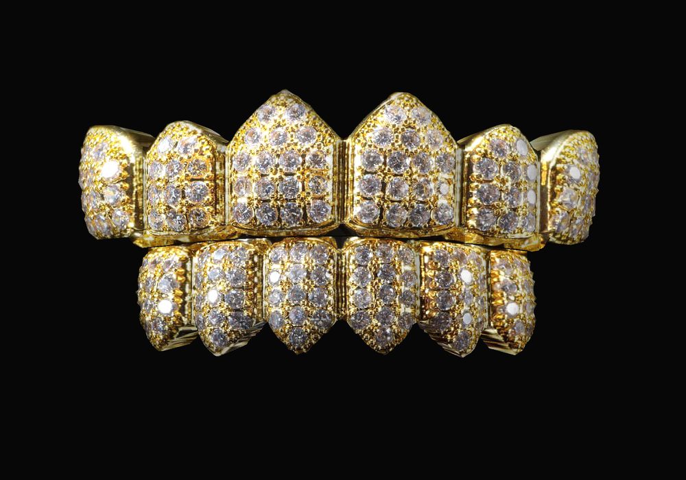
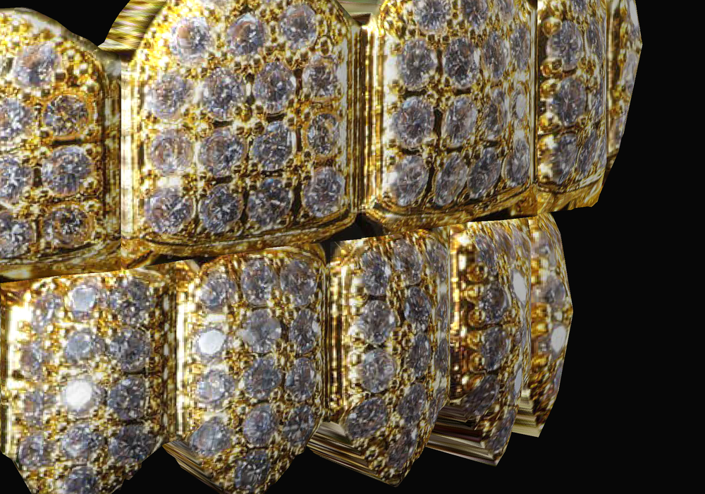
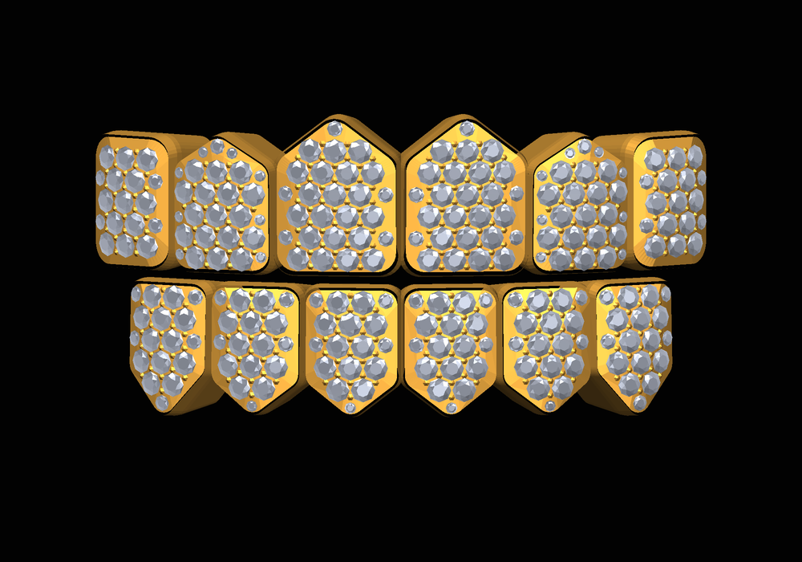
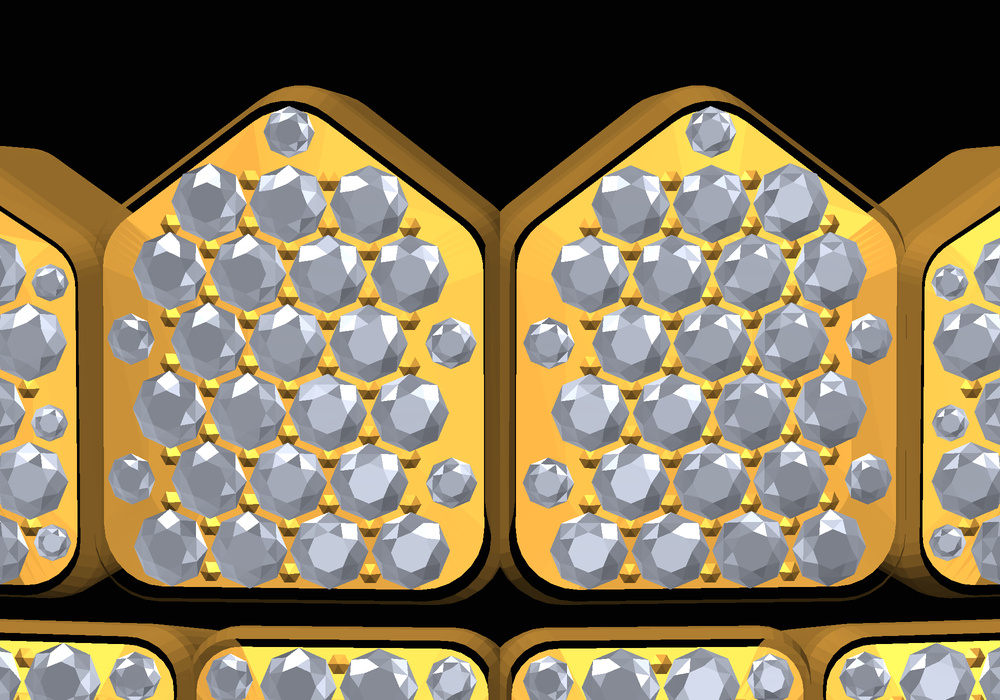

# Diamond Grillz

Iced-out gold grillz, 6 upper + 6 lower teeth, in three versions.

## Photo-textured (`grillz_photo.*`), 960 vertices

Each tooth is traced from the reference photo and wears its own piece of that photo
as its texture, so it looks like the real thing at under 1000 vertices.

| File | What it is |
| --- | --- |
| `grillz_photo.glb` | **Easiest:** one file, texture built in. Blender: File > Import > glTF 2.0. Roblox: Import 3D. |
| `grillz_photo.obj` / `.mtl` + `grillz_photo_texture.png` | Same model as OBJ; keep the three files in one folder. |
| `grillz_photo.py` | Rebuilds everything from the photo: `python3 grillz_photo.py photo.jpg` (Pillow + numpy). |

In Roblox, if the texture doesn't come through with the import, upload
`grillz_photo_texture.png` and set it as the MeshPart's `TextureID`.

The texture is cut from a watermarked product photo, which is probably copyrighted.
Check you have the right to use it before publishing a game with it.

## High detail (`grillz_detailed.*`), real 3D stones

Every stone is real faceted geometry: 240 stones (216 full-size, honeycomb packed, plus
24 accent stones in the tips and edges), a domed gold cap with a raised bezel lip, and
gold beads between the stones.

| Part | Vertices | Triangles |
| --- | --- | --- |
| Grillz Gold | 6,064 | 9,552 |
| Grillz Diamonds | 6,000 | 11,040 |

Each part is under Roblox's 20,000-triangle limit per MeshPart, so the importer brings
it in as two MeshParts. In Roblox set the gold part's Color to gold with Material
`Foil` or `Metal`, and the diamonds part to white with Material `Glass` and some Reflectance.

| File | What it is |
| --- | --- |
| `grillz_detailed.py` | Run inside Blender (Scripting > Open > Run Script) for real gold + diamond (IOR 2.42) materials, or `python3 grillz_detailed.py` to regenerate the OBJ. |
| `grillz_detailed.obj` / `.mtl` | Ready-made model, two objects (gold, diamonds). |

## Low poly (`grillz.*`), 972 vertices

| File | What it is |
| --- | --- |
| `grillz.py` | Builds the model. Run it inside Blender, or run `python3 grillz.py` to regenerate the OBJ. |
| `grillz.obj` / `grillz.mtl` | Ready-made model (one mesh, one material). |
| `grillz_diamond_pave.png` | 1024×1024 texture: diamond pave + plain gold strip. |
| `make_texture.py` | Repaints the texture (needs Pillow + numpy). |

## Blender
Scripting tab → **Open** → `grillz.py` → **Run Script**. You get a `Grillz` object with
a gold material and a procedural diamond-pave material (switch the viewport to
Material Preview or Rendered to see the stones). Or use File → Import → Wavefront (.obj).

## Roblox Studio
Home → **Import 3D** → `grillz.obj`, then set the MeshPart's `TextureID` to the uploaded
`grillz_diamond_pave.png` if it didn't come through automatically. Scale it to fit the
character's mouth and weld it to the Head.
