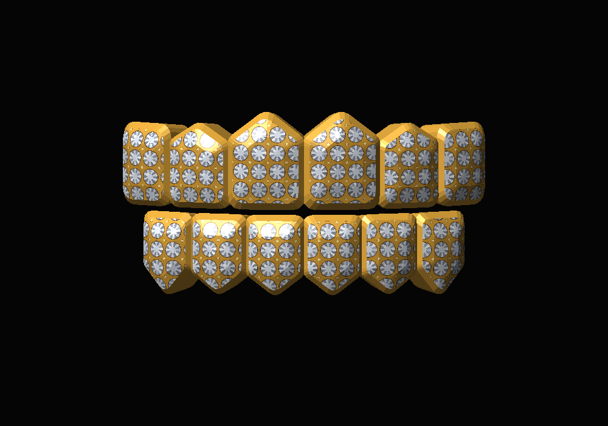

# Diamond Grillz

Low-poly iced-out gold grillz: 6 upper + 6 lower teeth, **972 vertices**.

| File | What it is |
| --- | --- |
| `grillz.py` | Builds the model. Run it inside Blender, or run `python3 grillz.py` to regenerate the OBJ. |
| `grillz.obj` / `grillz.mtl` | Ready-made model (one mesh, one material). |
| `grillz_diamond_pave.png` | 1024×1024 texture: diamond pave + plain gold strip. |
| `make_texture.py` | Repaints the texture (needs Pillow + numpy). |

## Blender
Scripting tab → **Open** → `grillz.py` → **Run Script**. You get a `Grillz` object with
a gold material and a procedural diamond-pave material (switch the viewport to
Material Preview or Rendered to see the stones). Or use File → Import → Wavefront (.obj).

## Roblox Studio
Home → **Import 3D** → `grillz.obj`, then set the MeshPart's `TextureID` to the uploaded
`grillz_diamond_pave.png` if it didn't come through automatically. Scale it to fit the
character's mouth and weld it to the Head.
