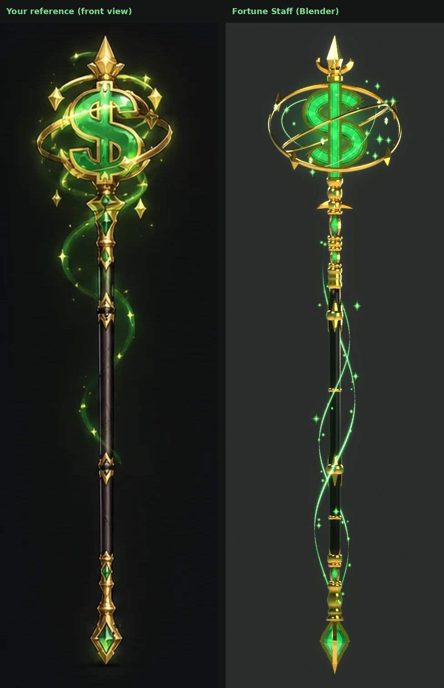
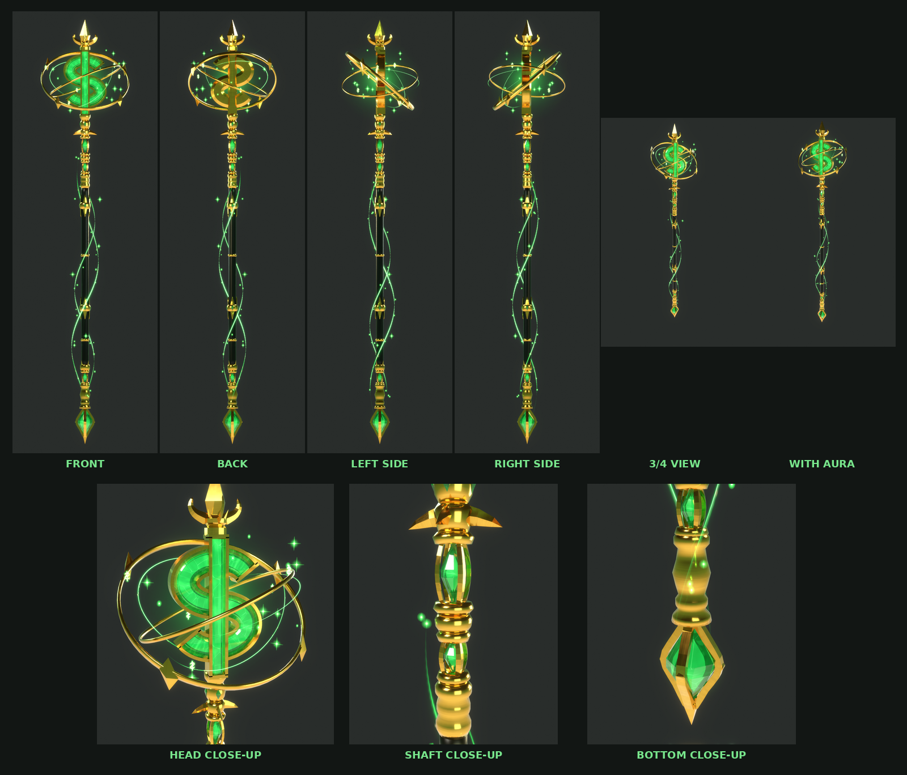
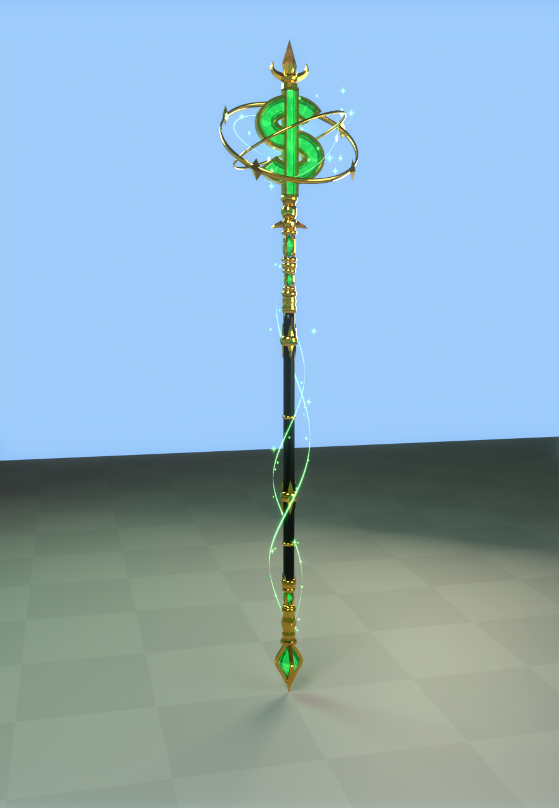
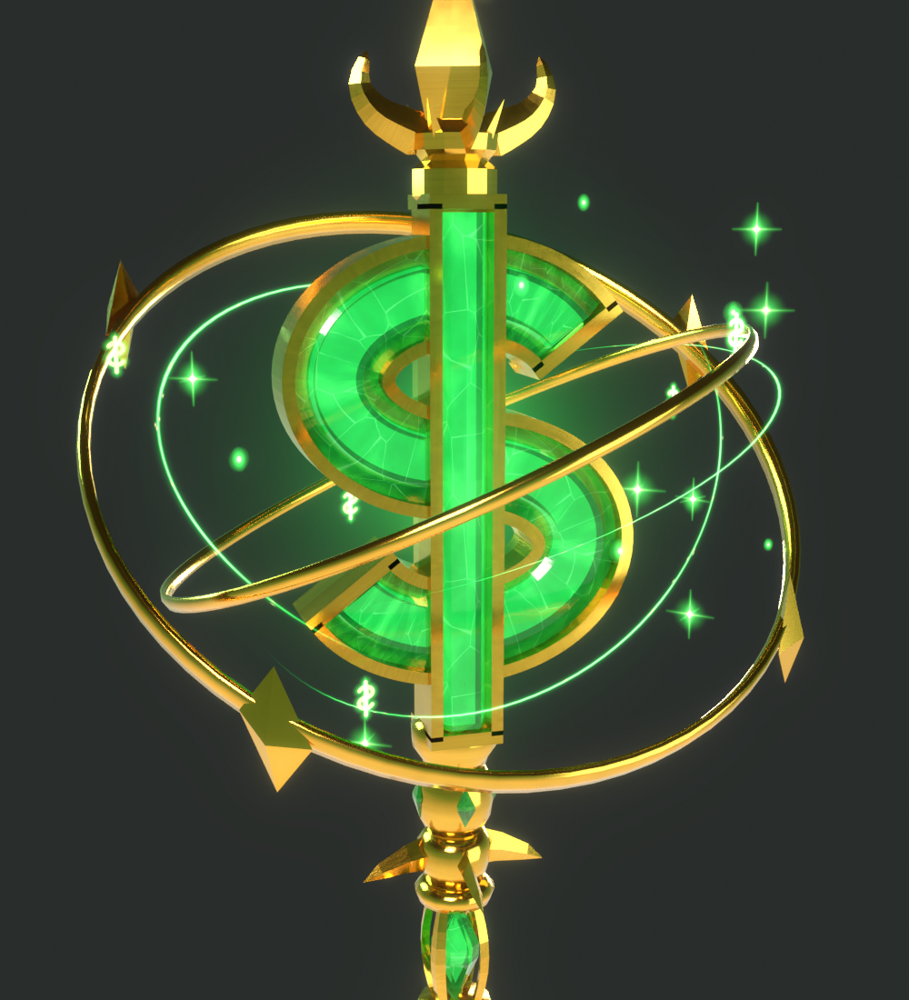

# Fortune Staff

The green and gold money staff from your reference sheet, built in Blender and set up as a
Roblox tool. It is a tall magical staff crowned by a big three-dimensional **$** in faceted
emerald and polished gold. Two gold rings orbit the symbol, the shaft is dark green-black with
gold bands and emerald inserts, and the foot is an emerald diamond in a gold frame. A subtle
green and gold aura surrounds it.

| Every view | In game | Head close-up |
| --- | --- | --- |
|  |  |  |

## How it matches the reference

The reference's front view was measured on a grid at 0.0095 studs per pixel, so the staff is
6.7 studs tall, with the sheet's proportions. Every outline in `blender/build_moneystaff.py`
comes from that.

- **The $ (the centrepiece):**
  - **Emerald:** a real 3D symbol. The S and its bar are faceted emerald (a raised face with
    bevelled edges), framed by polished gold rails on both edges and capped in gold at the
    ends.
  - **Gold setting:** a gold setting holds it from behind, so from the back it reads as a gold
    ornament, like the reference's back view.
  - **Bar:** the bar sits on top of the S, with its own gold outline.
  - **Glow:** a soft glowing heart inside the emerald gives it its magical glow.
- **The top:** a gold spearhead finial with fleur-de-lis leaves and small spikes on a gold crown
  and collar.
- **The orbit rings:**
  - **Rings:** a polished gold ring wraps round the symbol, passing behind it at the top and in
    front of it at the bottom. A thinner second ring crosses it.
  - **Stars:** four gold star ornaments ride the main ring.
  - **In Roblox:** the rings are their own part and slowly orbit the symbol.
- **Under the head:** a gold knot set with four small emeralds and pointed gold wings. Below it
  sit two emerald diamonds in gold sleeves with diamond windows (like the shaft detail) and
  turned gold bands.
- **Shaft:** slim dark green-black metal with a slight metallic finish.
  - **Band nodes:** two gold barrel bands, each with four small emeralds and pointed gold leaves
    above and below.
  - **Rings:** thin gold rings between the band nodes.
- **Foot:** a crown of gold points and another sleeved emerald, then turned gold bulbs. At the
  end is a big emerald diamond held in crossed gold kite frames, ending in a sharp gold point.

## The aura (subtle, close to the staff)

- **Strands:** thin emerald strands with a few gold flecks spiral up the shaft, over a faint
  soft mist.
- **Arcs:** energy arcs orbit the money symbol alongside the gold rings.
- **Particles:** small green and gold motes, occasional gold sparkles, and a few little
  glowing **$** symbols near the top.
- **Glow:** a soft emerald glow round the head and the foot gem.

It's built separately from the weapon (`export/MoneyStaffAura.fbx`). In Roblox the installer
rebuilds it with beams and particles. The aura keeps moving in game:

- **Flowing:** the strands' energy flows upward, and bright streams race up the spirals now and
  then.
- **Particles:** motes drift up, sparkles twinkle, and money symbols float round the head.
- **Light:** the head's green light breathes.
- **Rings:** the gold rings orbit.

## Attacks

- **Swing (click):** an emerald crescent slash with a bright gold edge, gold sparkles and a few
  spinning gold coins. A 3-hit combo.
- **Jackpot (E, gamepad Y, or the on-screen button on mobile):**
  - **Charge:** an emerald ring closes in on the money symbol.
  - **Burst:** two rings of emerald energy burst out round you, and a glowing money circle opens
    on the ground. A fountain of gold coins and money symbols showers up and out.
  - **Screen:** a green-gold screen flash, and a small camera shake for you.
  - **Damage:** it hits everything within 12 studs.

## Install in Roblox Studio

1. **Import 3D**: `export/MoneyStaff.fbx` (it becomes a model called `MoneyStaff`).
2. **Import 3D**: `export/MoneyStaffVFX.fbx`. This brings in the 10 effect textures.
3. **Model** tab > **Run Script** > `roblox/Installer.lua` (or paste it into View > Command Bar).
4. Press Play. *Fortune Staff* is in your backpack.

The installer reads marker cubes in the import, so the size and orientation come out right
whatever units the importer used. It puts:

- the Tool in **StarterPack**, with a copy in **ServerStorage**;
- the scripts in `ReplicatedStorage.MoneyStaff`, `ServerScriptService.StaffServer` and
  `StarterPlayerScripts.StaffClient`.

Running it again updates the scripts and keeps your `Config`.

**Tip:** add a `BloomEffect` to Lighting for the best glow.

**How it sits in the hand:** set this at the top of `Installer.lua`, then run it again.

- `GRIP_TILT` (75) tips the shaft up from pointing straight ahead. If it points at the ground,
  use -75.
- `GRIP_SPIN` turns the money symbol round the shaft.
- `STAFF_SCALE` resizes the staff and its aura.

## Materials you can control separately

The weapon is 5 meshes, each with its own material:

| Part | Material | Triangles |
| --- | --- | --- |
| `Shaft` | Dark green-black metal, slightly metallic (becomes the Tool's Handle) | 1,240 |
| `Gold` | Polished gold: the symbol's rails and setting, finial, bands, sleeves, frames | 9,216 |
| `Ring` | Polished gold: the two orbit rings and their stars (spins in game) | 1,760 |
| `Emerald` | Faceted emerald: the money symbol and every gem | 1,736 |
| `Glow` | Neon: the glowing hearts inside the emeralds | 1,040 |

That's 14,992 triangles in all, and every part is well under Roblox's per-mesh limit.

- **Gold and the shaft:** these keep their imported textures, with colour, metalness and
  roughness maps.
- **Emeralds:** `Config.CrystalStyle` = `"Glass"` (translucent gem, the default), `"Neon"`
  (solid glow) or `"Texture"` (opaque, with the painted facets).
- **Colours:** in `Config.Colors`.

The build script checks every part before export (`export/mesh_report.json`):

- **Clean meshes:** every piece is closed, with no holes, stray vertices or flat faces.
- **Normals:** all point outward.
- **Transforms:** applied, at 1 Blender unit = 1 stud.
- **Nothing floating:** no stray pieces. The rings deliberately float round the symbol: they're
  the magical orbit.

## Settings

Everything is in `ReplicatedStorage.MoneyStaff.Config`:

- **Colours** and **crystal style** (above).
- **Combat:** damage, ranges and cooldowns.
- **Aura:** `Aura` turns it on or off, and `AuraSpeed` sets the flow speed. `SpiralStreams` and
  `StreamSpeed` control the streams. `MoneySymbols` turns the floating symbols on or off.
- **Rings:** `SpinRing` and `RingSpeed`.
- **Attacks:** slash size and the Jackpot size.

## Hooking it into Pop or Drop

- `ReplicatedStorage.MoneyStaff.StaffHit` (a BindableEvent) fires on the server for every hit,
  with `(player, hitInstance, damage, isSpecial)`.
- Tag balloons or anything else **`SwordHittable`** with CollectionService and the staff hits
  them too. It's the same tag your other weapons use.
- Set `Config.Combat.DamageHumanoids = false` to handle damage yourself.

## Views

All in `previews/`:

- `front`, `back`, `left`, `right`
- `angle` (3/4 view)
- `head_closeup`, `shaft_closeup`, `bottom_closeup`
- `aura_full` (the whole staff with its aura)
- `ingame`
- `model_front` (no aura)
- `views.png` (all of them on one sheet)

## Files

| File | What it is |
| --- | --- |
| `export/MoneyStaff.fbx` / `.glb` | The weapon: 5 meshes plus 3 tiny marker cubes the installer uses and removes |
| `export/MoneyStaffAura.fbx` / `.glb` | The aura as meshes, separate from the weapon |
| `export/MoneyStaffVFX.fbx` / `.glb` | Carrier quads that bring the effect textures into Roblox |
| `export/MoneyStaff.blend` | The Blender scene |
| `roblox/Installer.lua` | Run once in Studio |
| `roblox/*.lua` | The scripts (edit these, then run `build_installer.py`) |
| `blender/build_moneystaff.py` | Rebuilds everything: `python build_moneystaff.py --render` (or `--shots=front,angle`) |
| `blender/money_textures.py` | Every texture: emerald, gold, the dark shaft, and the aura layers |
| `textures/` | Every texture as a PNG |

## Good to know

- I built and checked this in real Blender: renders, the mesh checks above, and the glTF
  validator (0 errors on all three files). The Luau scripts pass a syntax check and a linter.
  **They have not been run inside Roblox Studio yet**, so if anything prints an error, send it
  to me.
- **How it sits in the hand:** this is the part most likely to need a tweak. Change `GRIP_TILT`
  / `GRIP_SPIN` and run the installer again.
- **Ring spin:** the rings spin on each player's screen. Turn it off with
  `Config.VFX.SpinRing = false`.
