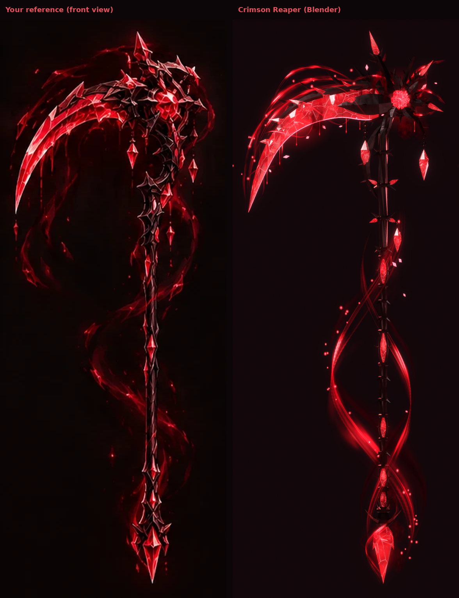
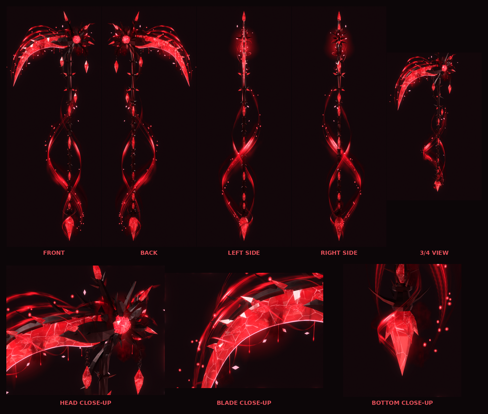
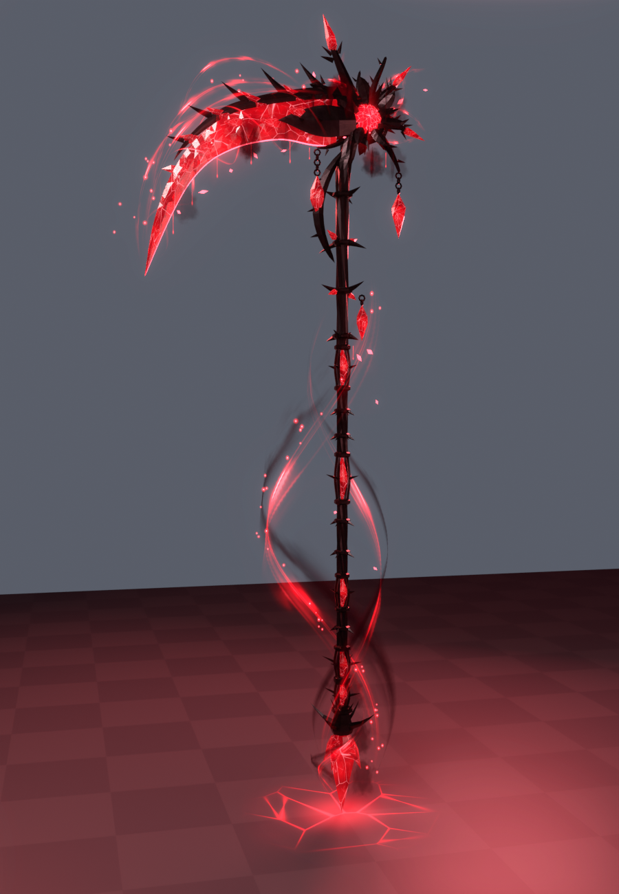
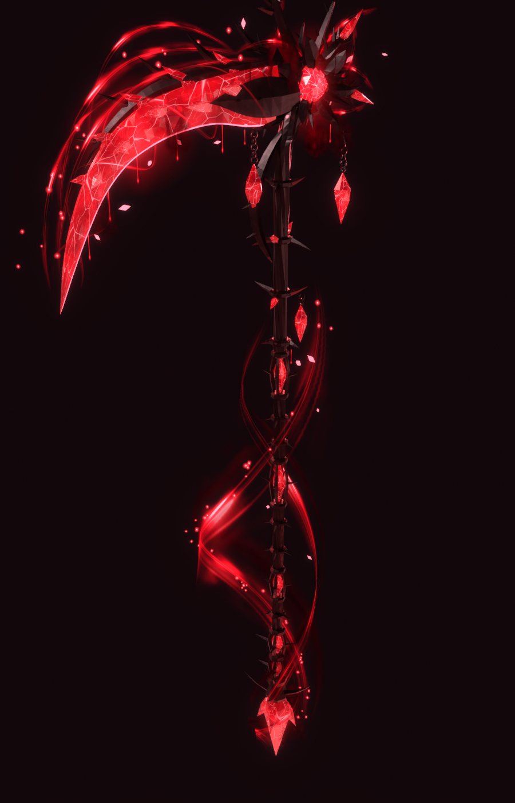

# Crimson Reaper

The crimson crystal scythe from your reference sheet, built in Blender and set up as a
Roblox tool. It has a faceted crimson crystal blade growing out of black gothic metal, a
thorny armoured head round a glowing crystal core, and a long spiked shaft with crystal
nodes. A red and black magical aura swirls round all of it.

| Every view | In game | 3/4 view |
| --- | --- | --- |
|  |  |  |

## How it matches the reference

The reference's front view was measured on a grid at 0.01 studs per pixel, so the scythe is
7 studs tall, like the sheet's proportions. Every outline in `blender/build_scythe.py` comes
from that.

- **Blade:** a long crescent of faceted crimson crystal with bright fracture lines in it.
  - **Spine:** a black metal spine caps its back, with barbs swept towards the tip.
  - **Crystal growths:** jagged crystal points break out of the back, and crystal growths
    push out of both faces. Armour plates grip the root, so the crystal looks like it grows
    out of the metal.
  - **Edge:** a thin glowing line runs along the cutting edge.
- **Head:** a faceted crystal core in a metal bezel and an angular frame. Thorny arms branch
  out of it.
  - **Arms:** the tall top spike, upper-right and right arms ending in crystal points, and
    smaller horns and spikes front and back.
  - **Armour and pendants:** armour scales are layered between the arms. Two crystals hang
    on chains from the lower arms.
- **Shaft:** a slim fluted black shaft with a slow twist in its flutes.
  - **Neck:** under the head, a neck with crowns of thorns (some with crystal points), a
    crescent hook and a third hanging crystal.
  - **Crystal nodes:** five long diamond crystals, each held in a cage of curved prongs with
    thorns.
  - **Thorns:** rings of small thorns run along the shaft.
- **Pommel:** a crown of claws flaring out round a big crystal point, with four smaller
  crystals angled down between them.

## The aura

The aura is built separately from the weapon (`export/ScytheAura.fbx`), so you can keep it,
change it or replace it. In Roblox, the installer rebuilds it with beams and particles,
because those move and glow. The aura is made of:

- **The swirl:** one big crimson strand wraps the shaft once from the pommel to the head in an
  S, like the reference. A thinner strand runs opposite it and a short one coils round the
  pommel. Each has a dark red / black smoky strand riding beside it and a faint wide mist
  under it.
- **Over the blade:** flame-like flares sweep off the blade's back towards the tip, and
  strands wrap round the blade.
- **From the core:** wisps rise out of the crystal core and curl away, so the energy starts at
  the crystal.
- **Particles:** floating crystal fragments, glowing sparks, magical drips off the edge, dark
  smoke, and a faint red glow round the blade, head and pommel.

In game it keeps moving:

- **Flowing:** the energy scrolls along the spiral and flare beams.
- **Streams:** bright streams race up the spirals.
- **Particles:** smoke, sparks and shards drift off the shaft, blade and core. Drips fall from
  the edge.
- **Light:** the core's red light breathes.

## Attacks

- **Swing (click):** a crimson crescent slash with a pink cutting edge and a dark smoky
  inside. It comes with a swing trail on the blade, sparks and flying crystal shards. A 3-hit
  combo.
- **Crimson Reap (E, gamepad Y, or the on-screen button on mobile):**
  - **Charge:** the core flares up.
  - **Spin:** two rings of crimson energy spin out round you, and the ground cracks open with
    red light. Crimson bursts go off all round you.
  - **Screen:** a crimson screen flash, and camera shake for the attacker.
  - **Damage:** it hits everything within 12 studs.

## Install in Roblox Studio

1. **Import 3D**: `export/Scythe.fbx` (it becomes a model called `Scythe`).
2. **Import 3D**: `export/ScytheVFX.fbx`. This brings in the 11 effect textures.
3. **Model** tab > **Run Script** > `roblox/Installer.lua` (or paste it into View > Command Bar).
4. Press Play. *Crimson Reaper* is in your backpack.

The installer reads marker cubes in the import, so the size and orientation come out right
whatever units the importer used. It puts:

- the Tool in **StarterPack**, with a copy in **ServerStorage**;
- the scripts in `ReplicatedStorage.CrimsonScythe`, `ServerScriptService.ScytheServer` and
  `StarterPlayerScripts.ScytheClient`.

Running it again updates the scripts and keeps your `Config`.

**Tip:** add a `BloomEffect` to Lighting for the strongest glow.

**How it sits in the hand:** set this at the top of `Installer.lua`, then run it again.

- `GRIP_TILT` (70) tips the shaft up from pointing straight ahead. If it points at the ground,
  use -70.
- `GRIP_SPIN` turns the blade round the shaft.
- `SCYTHE_SCALE` resizes the scythe and its aura.

## Settings

Everything is in `ReplicatedStorage.CrimsonScythe.Config`:

- **Colours:** crystal, glow, metal and light.
- **Crystal style:** `CrystalStyle` = `"Glass"` (translucent ruby, the default), `"Neon"`
  (solid glow) or `"Texture"` (opaque, with the painted fractures).
- **Combat:** damage, ranges and cooldowns.
- **Aura:** `Aura` turns it on or off. `AuraSpeed` sets the flow speed. `SpiralStreams`,
  `StreamSpeed` and `CorePulse` control the moving parts.
- **Attacks:** slash size and the Crimson Reap ring size.

## Hooking it into Pop or Drop

- `ReplicatedStorage.CrimsonScythe.ScytheHit` (a BindableEvent) fires on the server for every
  hit, with `(player, hitInstance, damage, isSpecial)`.
- Tag balloons or anything else **`SwordHittable`** with CollectionService and the scythe hits
  them too. It's the same tag the other swords use.
- Set `Config.Combat.DamageHumanoids = false` to handle damage yourself.

## Built for Roblox

The weapon is 6 separate meshes, so you can give each its own material or effect:

| Part | What it is | Triangles |
| --- | --- | --- |
| `Shaft` | Black metal: shaft, neck, crowns, node cages, pommel, chains (becomes the Tool's Handle) | 6,368 |
| `HeadArmor` | Black metal: bezel, frame, thorny arms, armour scales, blade spine and root plates | 3,888 |
| `Blade` | The crimson crystal blade with its growths and jagged points | 1,110 |
| `Crystals` | Shaft nodes, pommel crystals, arm crystal tips, hanging crystals | 436 |
| `Core` | The faceted crystal core | 80 |
| `Glow` | Neon: the cutting edge line and the core's heart (seen through the translucent gem) | 452 |

That's 12,334 triangles in all, and every part is well under Roblox's per-mesh limit. The
build script checks every part before export (`export/mesh_report.json`):

- **Clean meshes:** every piece is closed, with no holes, stray vertices or flat faces.
- **Normals:** all point outward.
- **Transforms:** applied, at 1 Blender unit = 1 stud.
- **Nothing floating:** every piece touches another one. The pendants hang on chains of
  touching links.

The weapon and the aura are separate files.

## Views

All in `previews/`:

- `front`, `back`, `left`, `right`
- `angle` (3/4 view)
- `head_closeup`, `blade_closeup`, `bottom_closeup`
- `ingame`
- `model_front`, `model_angle` (the weapon without its aura)
- `views.png` (all of them on one sheet)

## Files

| File | What it is |
| --- | --- |
| `export/Scythe.fbx` / `.glb` | The weapon: 6 meshes plus 3 tiny marker cubes the installer uses and removes |
| `export/ScytheAura.fbx` / `.glb` | The aura as meshes (ribbons, smoke, shards, sparks, drips, glow), separate from the weapon |
| `export/ScytheVFX.fbx` / `.glb` | Carrier quads that bring the effect textures into Roblox |
| `export/Scythe.blend` | The Blender scene |
| `roblox/Installer.lua` | Run once in Studio |
| `roblox/*.lua` | The scripts (edit these, then run `build_installer.py`) |
| `blender/build_scythe.py` | Rebuilds everything: `python build_scythe.py --render` (or `--shots=front,angle`) |
| `blender/scythe_textures.py` | Every texture: crystal, metal, and the aura layers |
| `textures/` | Every texture as a PNG |

## Good to know

- I built and checked this in real Blender: renders, the mesh checks above, and the glTF
  validator (0 errors on all three files). The Luau scripts pass a syntax check and a linter.
  **They have not been run inside Roblox Studio yet**, so if anything prints an error, send it
  to me.
- **How it sits in the hand:** this is the part most likely to need a tweak. Change `GRIP_TILT`
  / `GRIP_SPIN` (see above) and run the installer again.
- **Missing textures:** if the importer doesn't bring a texture in, the installer tells you
  which one. Upload the PNG from `textures/` and put its ID in `Config.Textures`.
