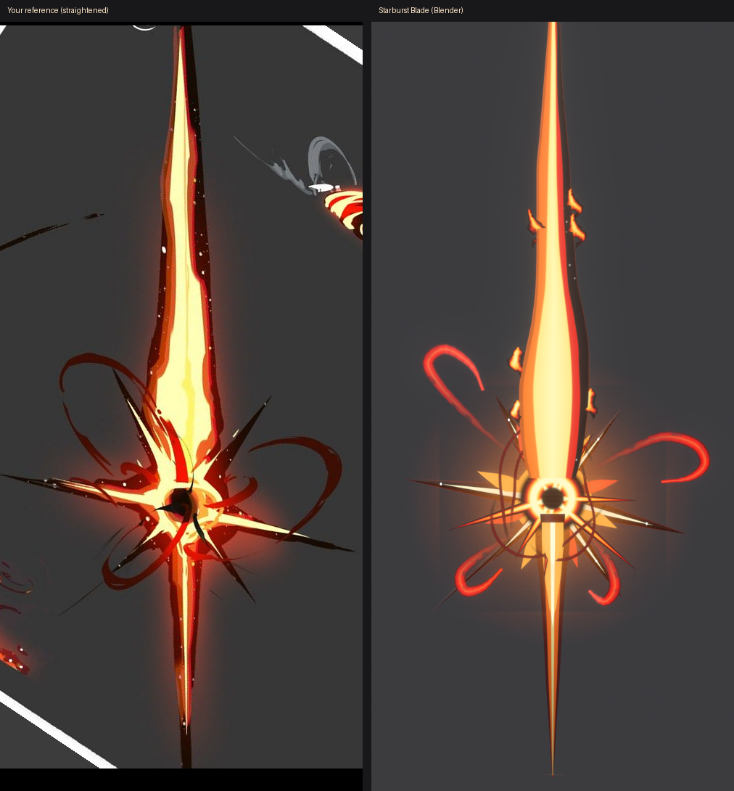
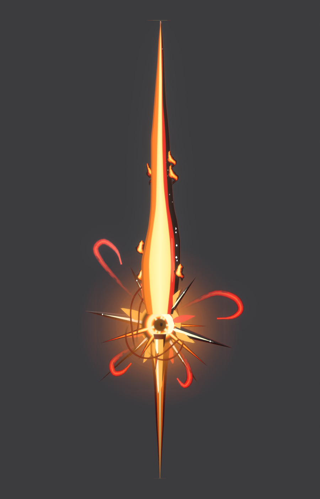
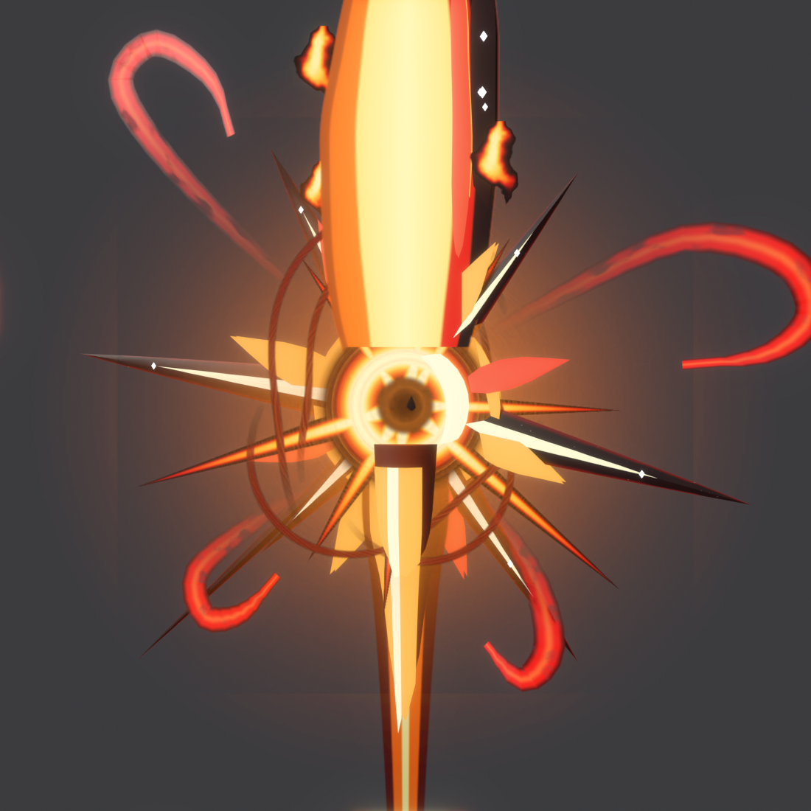
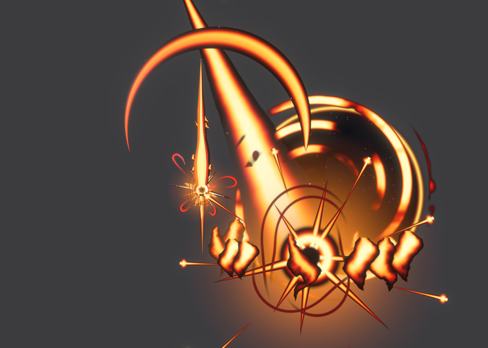

# Starburst Blade

The fiery sword from your effects sheet (item 3), built in Blender and set up as a
Roblox tool. The sheet's other items (the darts, ground flames, the starburst impact
and the portal swirl) became its effects.

| In game it reads as an effect | Star close-up | Special attack |
| --- | --- | --- |
|  |  |  |

## How it matches the reference

The reference sword was rotated upright around its star and measured. Every outline
in `blender/build_starburst.py` comes from that, at 0.004 studs per reference pixel, so
the sword is 4.5 studs long.

- **Blade:** a 748 px needle that swells into a flame-shaped leaf near the star. It has a
  yellow-white core, an orange band, an orange-brown rim on one edge, and a red band plus
  a dark crimson band with white sparkles on the other edge.
- **Star guard:** a black eye in a glowing yellow ring with an orange halo. It has seven
  tapered spikes at the measured angles and lengths (bright cores, dark edges), flame petals
  between them, and four curling **red swirl** ribbons.
- **Handle:** a 382 px tapering spike with dark red edges, an orange band and a thin yellow centre line.

## Why it looks like VFX and not a model

- Every visible part is **Neon**, including the dark outlines (deep crimson glow), so nothing is shaded like plastic.
- The blade and handle are drawn on top by **camera-facing beams** with textures painted from the
  measured reference (`fx_bladepaint.png`, `fx_handlepaint.png`), so they look hand-painted from every angle.
- The star **shimmers**: starburst sprites fade in and out on top of the 3D spikes, with a hot glow and a light.
- The ribbons are **red swirl trails** that keep tracing the reference's ribbon paths outward
  from the star. They smear into swirls when you swing.
- **Flame licks** crawl up the blade, embers rise, white sparkles twinkle, a ForceField
  heat shimmer wraps the blade, and fiery **darts** shoot off the star's spikes now and then.

## Effects

- **Swing:** a fire trail with dark rims and a soft glow trail, plus a painted crescent slash. The slash is
  built from beam segments, with a yellow core, orange and red bands and a dark rim. Sparks and darts fly off the tip.
- **Hit:** a dark-eyed starburst with a hot flash, sparks, embers and darts (sheet item 3).
- **Special (E):**
  - **Charge:** a spinning swirl gathers at the star.
  - **Strike:** a giant streak hits from the sky into a huge starburst. A dark starry portal with
    a fiery rim and swirl opens behind it (sheet item 4).
  - **Fire:** flames burst up from the ground (sheet item 2), with darts flying out.
  - **Screen:** a warm screen flash, and camera shake for the attacker.

## Install in Roblox Studio

1. **Import 3D**: `export/StarburstSword.fbx` (it becomes a model called `StarburstSword`).
2. **Import 3D**: `export/StarburstVFX.fbx`. This brings in all the effect textures.
3. **Model** tab > **Run Script** > `roblox/Installer.lua` (or paste it into View > Command Bar).
4. Press Play. *Starburst Blade* is in your backpack: click to slash, press **E** (gamepad Y / the
   on-screen button on mobile) for the special.

The installer reads marker cubes in the import, so the size and orientation come out right
whatever units the importer used. It puts:

- the Tool in **StarterPack**, with a copy in **ServerStorage**;
- the scripts in `ReplicatedStorage.StarburstSword`, `ServerScriptService.StarburstServer` and
  `StarterPlayerScripts.StarburstClient`.

Running it again updates the scripts and keeps your `Config`.

**Tip:** add a `BloomEffect` to Lighting for the strongest glow.

## Settings

Everything is in `ReplicatedStorage.StarburstSword.Config`:

- **Colours:** the colour of every glowing part.
- **Combat:** damage, ranges and cooldowns.
- **Controls and feel:** the special attack key, slash angles, sounds and animations.
- **Textures:** overrides for any effect texture.
- **Idle extras:** the swirl speed, width and length, the darts, and the screen flash and shake.

To resize the sword, change `SWORD_SCALE` at the top of `Installer.lua` and run it again.

## Hooking it into Pop or Drop

- `ReplicatedStorage.StarburstSword.SwordHit` (a BindableEvent) fires on the server for every hit,
  with `(player, hitInstance, damage, isSpecial)`.
- Tag balloons or anything else **`SwordHittable`** with CollectionService and the sword hits them too.
- Set `Config.Combat.DamageHumanoids = false` to handle damage yourself.

The Mo Feng Blade (`models/sword`) is a separate package, so both swords work in the same game.

## Files

| File | What it is |
| --- | --- |
| `export/StarburstSword.fbx` / `.glb` | The sword: 7 meshes, 14,284 triangles |
| `export/StarburstVFX.fbx` / `.glb` | Carrier quads that bring the 16 effect textures into Roblox |
| `export/StarburstSword.blend` | The Blender scene |
| `roblox/Installer.lua` | Run once in Studio |
| `roblox/*.lua` | The scripts (edit these, then run `build_installer.py`) |
| `blender/build_starburst.py` | Rebuilds the model, textures, exports and previews (`--render`) |
| `blender/fire_textures.py` | All the effect textures, painted in the sheet's style |
| `textures/` | Every texture as a PNG |

## Good to know

- I built and checked this in real Blender: renders, and the glTF validator (0 errors). The Luau scripts
  pass a syntax check and a linter. **They have not been run inside Roblox Studio yet**, so if
  anything prints an error, send it to me.
- The camera-facing blade paint shows the dark sparkle band on one edge from the front. From the
  other side it mirrors, the same as a real double-sided effect.
- If the importer doesn't bring a texture in, the installer tells you which one is missing. Upload the PNG
  from `textures/` and put its ID in `Config.Textures`.
