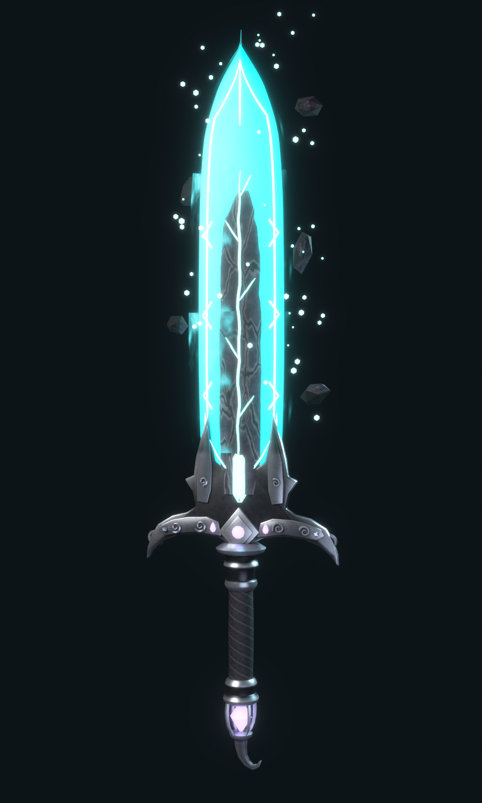
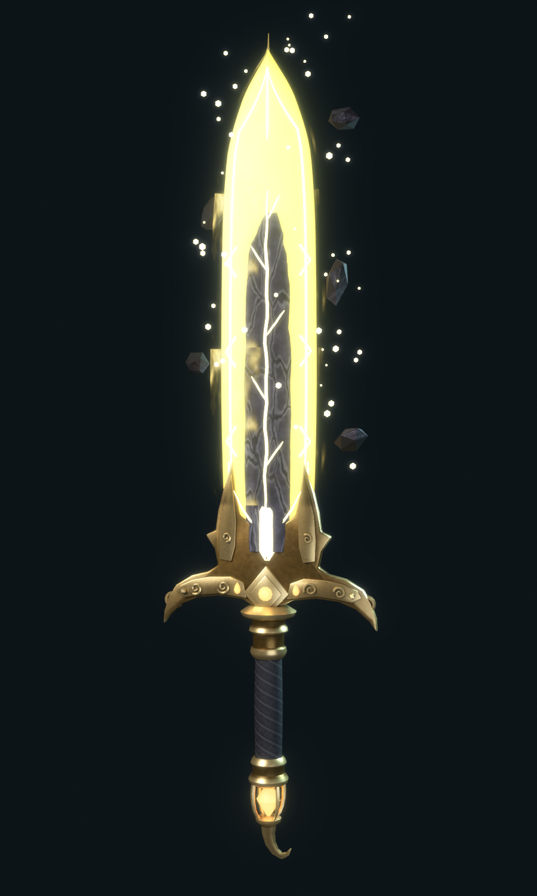
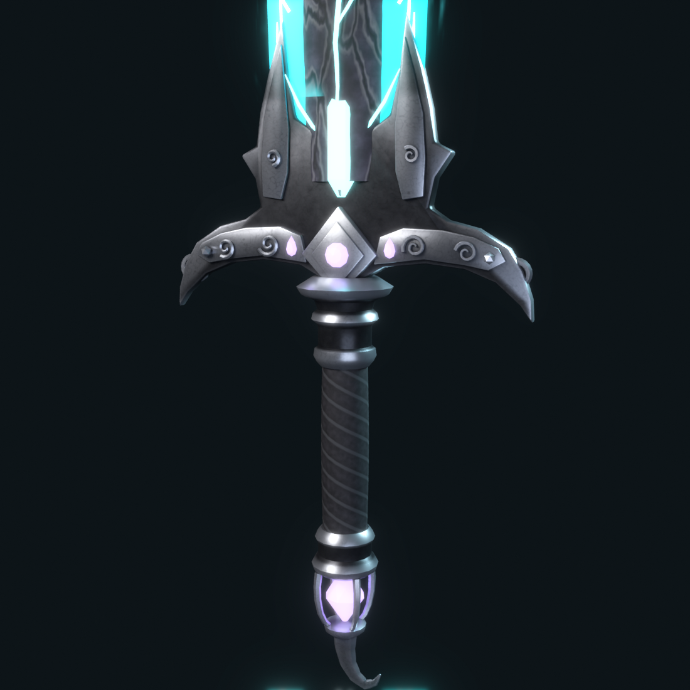
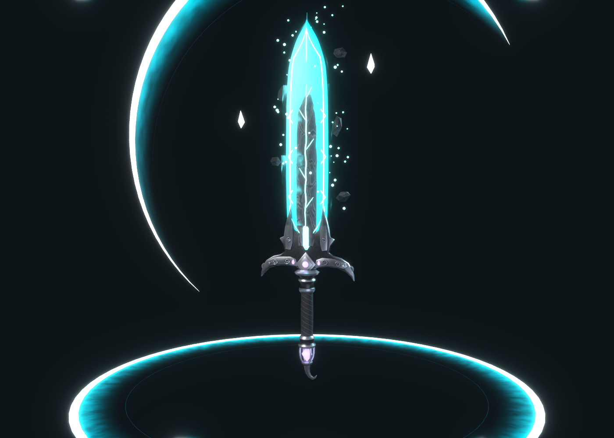

# Mo Feng Blade

A premium Roblox greatsword built in Blender from two references. The shape and the
cyan look come from *Jin Jiu Gai · Mo Feng*: a dark cracked stone core set in glowing
crystal edges, a horned winged guard, a guard crystal, and a gem pommel under a curled
finial. The gold reference adds the swept spiky wing tips, the flame-shaped accent gems
and a second colour theme.

| Cyan (default) | Gold theme | Hilt |
| --- | --- | --- |
|  |  |  |

*These are Blender renders. In Roblox, the floating motes, flames and lightning are
particle effects, and the slash and ring are the VFX meshes shown above.*

## What's in here

| Folder / file | What it is |
| --- | --- |
| `export/MoFengSword.fbx` (`.glb`) | The sword: 8 meshes, 6,738 vertices / 12,362 triangles in total |
| `export/MoFengVFX.fbx` (`.glb`) | Slash arcs, shockwave rings, crystal shards, rock fragments, and all the VFX textures |
| `export/MoFengSword.blend` | The full Blender scene |
| `roblox/Installer.lua` | Run once in Studio; builds the Tool, effects and scripts |
| `roblox/*.lua` | The scripts the installer puts in your game (edit these, then run `build_installer.py`) |
| `textures/` | Every texture as a PNG, in case you want to upload one by hand |
| `blender/build_mofeng.py` | Rebuilds everything above from scratch in Blender |

### Sword parts

| Part | Tris | In Roblox |
| --- | --- | --- |
| `Handle` | 448 | wrapped grip (the Tool's handle), textured |
| `Hilt` | 7,088 | guard, horn scrolls, studs, collars, gem cage and finial; baked silver texture (gold for the Gold theme) |
| `BladeCore` | 1,654 | broken stone slab, baked texture |
| `BladeEdge` | 1,838 | crystal blade and cutting edges, **Neon** |
| `BladeRunes` | 340 | engraved lines and chevrons, **Neon** (pale) |
| `EnergyVeins` | 296 | glowing crack, its branches and the guard crystal, **Neon** |
| `AccentGems` | 188 | pommel gem, medallion gem and teardrop gems, **Neon** |
| `BladeAura` | 510 | energy shell around the blade, **ForceField** material (animated flow) |

## Install in Roblox Studio

1. **Import the sword.** Go to *Home* (or *Avatar*) > **Import 3D**, pick `export/MoFengSword.fbx`
   and click Import. Keep the default settings. It lands in Workspace as a model called `MoFengSword`.
2. **Import the effects.** Do the same with `export/MoFengVFX.fbx`; it becomes `MoFengVFX`.
   (The `.glb` files work too, if your Studio prefers glTF.)
3. **Run the installer.** Go to the *Model* tab > **Run Script** and pick `roblox/Installer.lua`.
   No Run Script button? Open *View* > **Command Bar**, paste in the whole contents of
   `Installer.lua` and press Enter.
4. **Press Play.** *Mo Feng Blade* is in your backpack.

The installer reads three tiny marker cubes in each import to work out exactly how Studio
scaled and rotated the files, so the sword comes out the right size whichever unit setting
the importer used. Then it:

- welds the meshes and sets up the grip;
- adds the attachments, particles, trails, beams, lights and sounds;
- moves the VFX meshes to `ReplicatedStorage.MoFengSword.Assets`;
- installs `ReplicatedStorage.MoFengSword` (Config, SwordVFX, Remote, SwordHit),
  `ServerScriptService.MoFengSwordServer` and `StarterPlayerScripts.MoFengSwordClient`;
- puts the Tool in **StarterPack**, with a copy in **ServerStorage** for giving it out by script.

It prints notes in the Output window if anything is missing. Running it again updates the
scripts and keeps your `Config`.

**Tip:** for the strongest glow, add a `BloomEffect` to Lighting (Intensity ~1, Size ~24, Threshold ~0.9).

## Controls

| Input | Action |
| --- | --- |
| Click / tap | 3-hit slash combo (12 / 12 / 18 damage) |
| **E**, gamepad **Y**, or the on-screen *Special* button | Special attack: a charge, a huge slash, a shockwave, a flash and 35 area damage (6 s cooldown) |

## The effects

- **Idle (always on while held):**
  - **Neon parts:** crystal edges, runes, veins and gems glow.
  - **Aura:** a ForceField shell ripples over the blade.
  - **Energy flow:** a scrolling beam runs up the blade, plus a soft glow beam around it.
  - **Particles:** flame wisps (a 16-frame flipbook) lick off the blade, and motes drift up and fade.
  - **Hilt glow:** halos around the guard and the pommel gem, and a glint at the tip.
  - **Extras:** rock fragments orbit the blade, small lightning arcs crackle across it, and energy bursts go off every few seconds.
- **Swing:**
  - **Trails:** a bright core trail plus a longer soft glow trail follow the blade.
  - **Slash:** a crescent arc (ForceField gradient with a Neon core) sweeps in front of you and fades in a quarter of a second.
  - **Debris:** sparks scatter off the blade, crystal fragments and shards fly from the tip, and the blade flashes brighter.
- **Special:**
  - **Charge:** the blade's particles triple and its light flares while it charges.
  - **Slash:** two layered giant slashes travel forward.
  - **Impact:** two expanding shockwave rings on the ground, an exploding burst of sparks, embers and flash, flying shards, and a big light flash.
  - **Screen:** a short screen flash for nearby players, and camera shake for the attacker.
- **Hits:** a spark, flash and mini ring burst on everything you hit.

Everything is coloured by the sword's theme, so effects never clash with the blade.

## Settings

- **Colour theme:** select the Tool and change its **`Theme`** attribute to `Cyan` or `Gold`.
  You can also change `Config.DefaultTheme`. The Gold theme also swaps the hilt to its gold texture.
- **Size:** change `SWORD_SCALE` at the top of `Installer.lua` (0.8 = smaller) and run it again.
- **Gameplay and effects:** edit `ReplicatedStorage.MoFengSword.Config`. It holds:
  - damage, ranges and cooldowns;
  - the special attack key;
  - the slash angles for each combo hit;
  - sounds and animations;
  - texture overrides;
  - which idle extras run.
- **Animations:** by default the sword uses Roblox's built-in tool slash and lunge. For slashes
  that match your own swings, make animations, put their IDs in `Config.Animations`, and adjust
  `Config.SlashAngles`.

## Hooking it into Pop or Drop

- `ReplicatedStorage.MoFengSword.SwordHit` (a BindableEvent) fires on the server for every hit,
  with `(attackerPlayer, hitInstance, damage, isSpecial)`.
- Tag any part or model **`MoFengHittable`** (for example balloons) with CollectionService.
  The sword then hits it and fires `SwordHit` for it, so your code can pop it.
- Set `Config.Combat.DamageHumanoids = false` if your game should handle damage itself.
- To hand the sword out from a shop instead of StarterPack, delete it from StarterPack and
  clone `ServerStorage["Mo Feng Blade"]` into a player's Backpack.

Hits are checked on the server, along with cooldowns and a check that the sword is actually
equipped. Each player's client plays the effects; other players see them through the server.

## Rebuilding

- **Model:** `blender/build_mofeng.py` builds the whole model with Blender's Python. Run it in
  Blender (*Scripting* > Open > Run Script; it starts a new empty scene), or headless with the
  `bpy` module (`python build_mofeng.py --render` also makes the previews). It bakes the stone,
  metal and wrap textures in Cycles, generates the VFX textures, and writes everything into
  `export/`, `textures/` and `previews/`.
- **Installer:** `roblox/build_installer.py` rebuilds `Installer.lua` after you edit any of the
  scripts in `roblox/`.

## Good to know

- I built and checked this in real Blender (5.2): renders, Cycles bakes, and the glTF validator
  (0 errors). The Luau scripts pass a syntax check and a linter. **They have not been run inside
  Roblox Studio yet**, so if the installer or a script prints an error, send it to me and I'll fix it.
- In first person, the sword stays visible but floats, because Roblox hides your arms there.
- If the importer doesn't bring a texture in, the installer tells you which one.
  - Sword textures: upload the matching PNG from `textures/` and set it as that part's `TextureID`.
  - Particle textures: paste the uploaded ID into `Config.Textures`.
  - Until then, missing particle textures fall back to Roblox's built-in sparkle.
